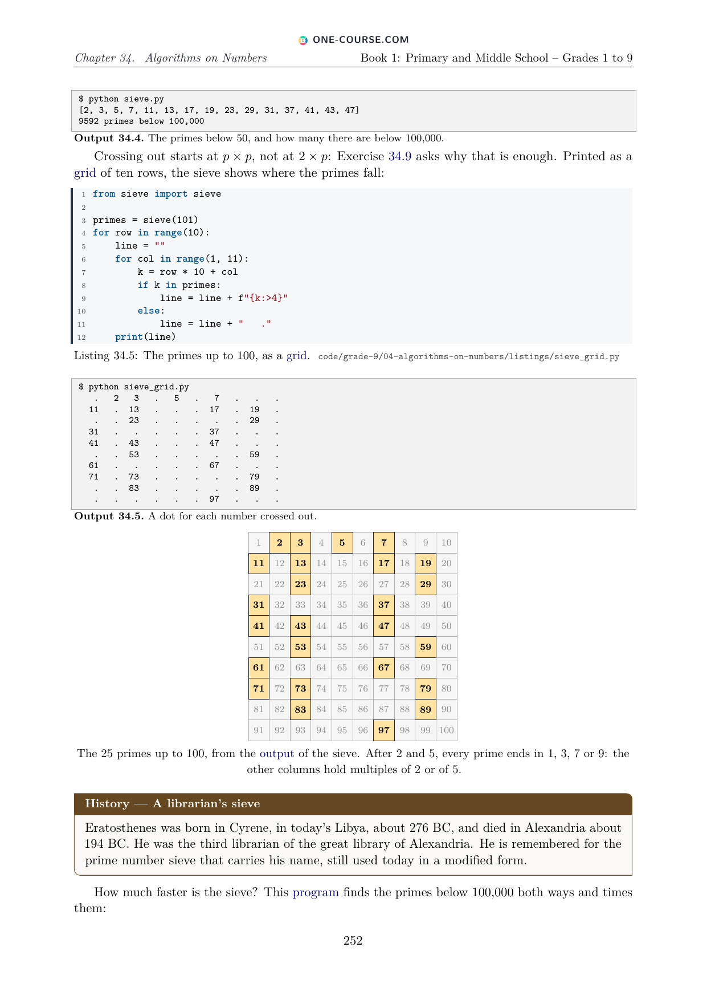
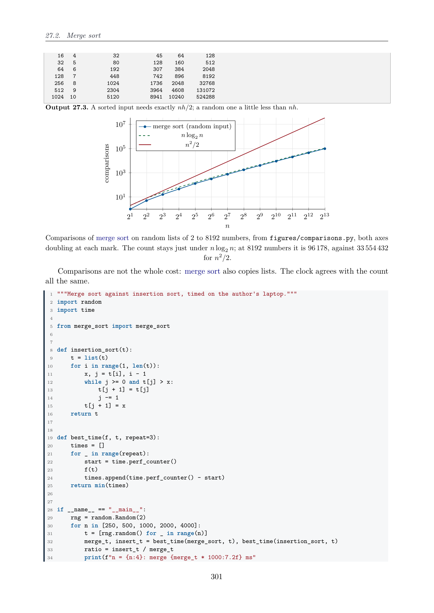
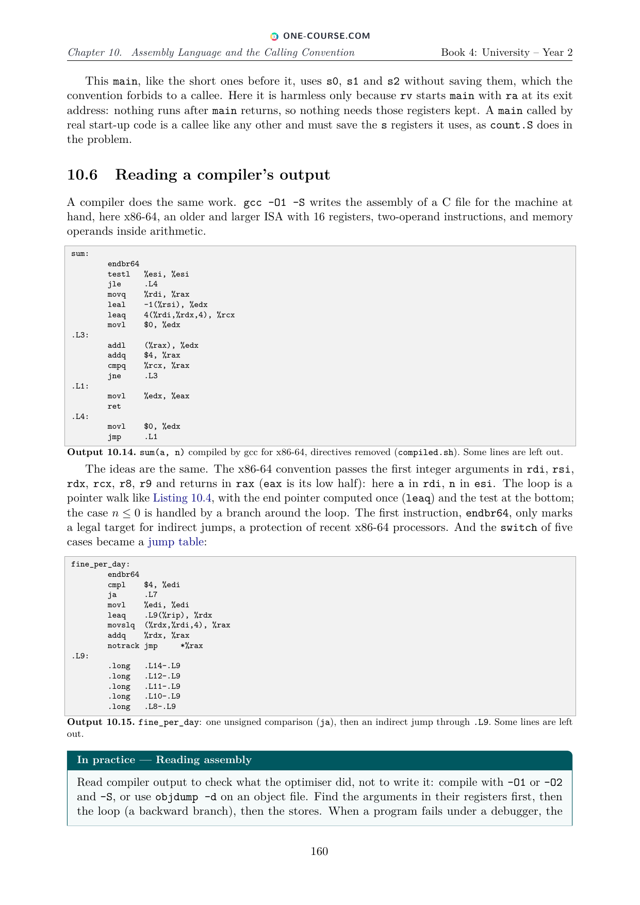

# One Computer Science Book

<p align="center">
  <a href="https://one-course.com">
    
  </a>
</p>

<p align="center">
  <a href="https://github.com/bvirrion/one-computer-science-book/releases/latest"></a>
  <a href="https://github.com/bvirrion/one-computer-science-book/releases"></a>
  <a href="https://github.com/bvirrion/one-computer-science-book/actions/workflows/release.yml"></a>
  <a href="https://one-course.com/books"></a>
</p>

*The One Computer Science Book to Rule Them All.*

> **One Computer Science Book** is part of the **One Course** project — one coherent
> course covering each subject from kindergarten to the end of the
> bachelor's degree. Discover the whole project at
> **[one-course.com](https://one-course.com)**, and see the siblings
> [One Math Book](https://github.com/bvirrion/one-math-book),
> [One Physics Book](https://github.com/bvirrion/one-physics-book),
> [One Chemistry Book](https://github.com/bvirrion/one-chemistry-book),
> [One Biology Book](https://github.com/bvirrion/one-biology-book),
> [One Earth and Space Sciences Book](https://github.com/bvirrion/one-earth-and-space-sciences-book),
> [One Economics Book](https://github.com/bvirrion/one-economics-book) and
> [One Quant Book](https://github.com/bvirrion/one-quant-book).

A series of five **free computer science textbooks** forming a single
coherent course **from Grade 1 to the end of the bachelor's degree** — one
notation, one voice, every year building on the previous one. The books are
written in **English**. Whether you are a student, a parent, a teacher or a
homeschooling family, you can read every book online or download the PDF —
free of charge:

1. **Primary & Middle School Computer Science** — Grades 1–9;
2. **High School Computer Science** — Grades 10–12;
3. **University Computer Science — Year 1**;
4. **University Computer Science — Year 2**;
5. **University Computer Science — Year 3**.

The course starts with **the machine, not with a block language**: Grades 1–5
teach the hardware, typing with ten fingers, files, memory and storage, the
operating system, binary, and algorithms carried out by hand. **Python starts
in Grade 6** and is the only language of the school years. The university
books add **C, C++, Rust and SQL**, and go from the processor (a toy machine,
then RISC-V assembly) to operating systems, networks, databases, compilers,
algorithms and the theory of computation.

The style is concise and rigorous: courses built from **definitions,
examples, propositions and methods**, followed by graded **exercises and a
weekend problem with full solutions** collected at the end of each book.

- **Every listing is a tested file.** No program is typed into a book: each
  listing is included from a source file in this repository, and that file
  has tests.
- **Every output is captured.** The output printed under a program is what
  the program really printed; one command reruns every program and compares
  the result with the book, byte for byte.
- **Errors shown on purpose.** A compile error, a crash or a wrong answer is
  printed when it teaches something, and the text says so. The C and C++
  programs are tested with the address and undefined-behaviour sanitizers.
- **One town to compute on.** Exercises on data, graphs and databases use an
  invented town, Brenmoor, generated by code, so every query has an exact
  answer.

Thousands of generated hyperlinks send every defined term back to its
definition, and every exercise to its solution.

<p align="center">
  
  
  
</p>
<p align="center"><sub>Three pages: the sieve of Eratosthenes (Book 1), merge sort (Book 2), a compiler's output (Book 4).</sub></p>

## Read online · Download the PDFs

| Book | Read online | Download PDF |
|------|-------------|--------------|
| **1. Primary & Middle School** (Grades 1–9) | [EN](https://one-course.com/books/computer-science/1/en) | [EN](https://github.com/bvirrion/one-computer-science-book/releases/latest/download/one_computer_science_book_1_primary_middle_school.pdf) |
| **2. High School** (Grades 10–12) | [EN](https://one-course.com/books/computer-science/2/en) | [EN](https://github.com/bvirrion/one-computer-science-book/releases/latest/download/one_computer_science_book_2_high_school.pdf) |
| **3. University — Year 1** | [EN](https://one-course.com/books/computer-science/3/en) | [EN](https://github.com/bvirrion/one-computer-science-book/releases/latest/download/one_computer_science_book_3_university_year_1.pdf) |
| **4. University — Year 2** | [EN](https://one-course.com/books/computer-science/4/en) | [EN](https://github.com/bvirrion/one-computer-science-book/releases/latest/download/one_computer_science_book_4_university_year_2.pdf) |
| **5. University — Year 3** | [EN](https://one-course.com/books/computer-science/5/en) | [EN](https://github.com/bvirrion/one-computer-science-book/releases/latest/download/one_computer_science_book_5_university_year_3.pdf) |

Every book can be read online, chapter by chapter, and the PDF links always
point at the newest release. Spotted a mistake in any book? Please
[report an erratum](https://github.com/bvirrion/one-computer-science-book/issues/new?template=errata.yml) —
fixes usually ship within days.

## Current status

**All five books are written**, in English: 165 chapters in all.

| Book | Level | Status |
|------|-------|--------|
| Primary & Middle School | Grades 1–9 (age 6–15) | ✅ 37 chapters, 428 exercises, 21 weekend problems, solutions — about 400 pages |
| High School | Grades 10–12 (age 15–18) | ✅ 35 chapters, 525 exercises, 32 weekend problems, solutions — about 525 pages |
| University — Year 1 | Bachelor Year 1 (age 18–19) | ✅ 30 chapters, 360 exercises, 29 weekend problems, solutions — about 525 pages |
| University — Year 2 | Bachelor Year 2 (age 19–20) | ✅ 31 chapters, 372 exercises, 30 weekend problems, solutions — about 645 pages |
| University — Year 3 | Bachelor Year 3 (age 20–21) | ✅ 32 chapters, 384 exercises, 31 weekend problems, solutions — about 585 pages |

## Building the books

Requirements: TeX Live 2026 with `latexmk` (packages used: `listings`,
`tcolorbox`, `pgfplots`, `forest`, `bytefield`, `cleveref`, `imakeidx`, …),
and for the code Python 3.12, a C and C++ compiler, Rust and SQLite.

```sh
make                # or just: latexmk — builds all five books into build/
make venv           # create .venv (pytest, ruff, hypothesis)
tools/test_code.sh  # every listing, every printed output, every test
```

The PDFs are produced at `build/one_computer_science_book_<N>_<slug>.pdf`,
with `N` = 1–5 and `slug` ∈ {`primary_middle_school`, `high_school`,
`university_year_1`, `university_year_2`, `university_year_3`}. To build a
single book, e.g. `latexmk one_computer_science_book_2_high_school.tex`.

## Repository layout

```
one_computer_science_book_<N>_*.tex   entry file per book (N = series number)
styles/onecs.sty               packages, environments, macros, listing and output boxes
styles/lang/<lang>.tex         UI strings
frontmatter/                   title page, preface (shared layout)
parts/<year>/part.tex          shared structure for a year
parts/<year>/NN-*.tex          chapter
parts/<year>/solutions/        solutions
code/<year>/NN-*/              per chapter: listings/, outputs/ (captured), exercises/, tests/
code/shared/                   the toy machine, the RISC-V simulator, the invented town
tools/                         output capture, code tests, gates, HTML reader converter
```

## Contributing

Contributions are welcome — corrections, clearer programs, additional exercises, new chapters. Please read
[CONTRIBUTING.md](CONTRIBUTING.md) for the structure, environments and
style conventions of the project. The fastest way to help is to
[report an erratum](https://github.com/bvirrion/one-computer-science-book/issues/new?template=errata.yml)
when you spot a mistake.

## Contributors

- Benjamin Virrion
- Claude (Anthropic)

## License

- **How to credit**: One Computer Science Book, One Course (one-course.com).
- **Book content** — the LaTeX sources, figures, and the PDF and HTML editions — is licensed under
  [Creative Commons Attribution-NonCommercial-ShareAlike 4.0](https://creativecommons.org/licenses/by-nc-sa/4.0/)
  (CC BY-NC-SA 4.0): you may share and adapt it, including translating it, with credit to
  One Computer Science Book, for non-commercial purposes, and adaptations must use the same licence. See [`LICENSE`](LICENSE).
- **Software** — `code/`, `tools/`, `.github/`, the `Makefile` and the build scripts — is licensed under the MIT licence: see [`LICENSE-CODE`](LICENSE-CODE).
- **Third-party material** (photographs, public-domain images, bundled fonts) keeps its own licence, as listed in
  the books' image-credit pages.
- **Names and logos**: "One Course" and "One Computer Science Book" are not covered by these licences.
- **Commercial use** (print editions, licences for schools, publishers or companies): contact One Course via [one-course.com/contact](https://one-course.com/contact).

Contributions are accepted under these licences with a signed-off commit — see
[`CONTRIBUTING.md`](CONTRIBUTING.md#licensing-of-contributions).
